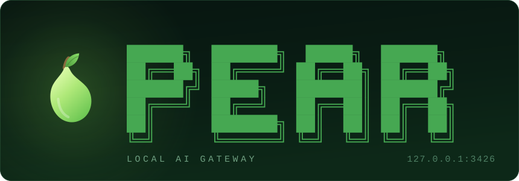

<!-- readme-theme: phosphor-archive / archetype-c / hero-svg -->
<div align="center">



**装一个二进制，让所有 AI 客户端指向 `127.0.0.1:3426`。**

**[English](README.md)** · [简体中文](README.zh-CN.md) · [繁體中文](README.zh-TW.md)

[](https://go.dev)
[](go.mod)
[](LICENSE)
[](#install)

</div>

## 📦 安装

选一条路径，装完跑 `pear version`。约 1 分钟。

**1 · 用 mise 从 GitHub Releases 装** — 不用 clone，不用 Go 工具链。

```bash
mise use -g "github:alexxhchen-nu/pear@0.1.5"
pear version          # pear v0.1.5
```

> mise 会隐藏发布不满 24 小时的版本（`minimum_release_age`）。
> 照上面显式写版本号，或明天再用 `@latest`。

**2 · 用 mise 从源码构建** — 任何 commit 都能用，不需要 tag。

```bash
git clone https://github.com/alexxhchen-nu/pear.git
cd pear
mise install          # 由 mise.toml 提供 Go 工具链
mise run build        # -> ./pear（或 pear.exe）
```

**3 · `go install`** — 需要 Go 1.24+ 和已打 tag 的发布。

```bash
go install github.com/alexxhchen-nu/pear/cmd/pear@latest
```

**4 · 预编译包** — 从
[Releases](https://github.com/alexxhchen-nu/pear/releases) 下载，
先拿 `checksums.txt` 核对。

```bash
shasum -a 256 pear_darwin_arm64.tar.gz
```

> `scoop`、Homebrew、winget、AUR 还没发布。它们只写在下面的路线图里，
> 这里不假装已经有了。

## ⚡ 启动

四步，约 30 秒。

1. `pear status` — 看加载了什么：providers、accounts、groups。
2. `pear serve` — 前台网关，监听 `127.0.0.1:3426`。
3. 把客户端指过来（两种原生 base URL 都认）：

```bash
export ANTHROPIC_BASE_URL=http://127.0.0.1:3426
export OPENAI_BASE_URL=http://127.0.0.1:3426/v1
```

4. 确认它活着：

```bash
curl -s http://127.0.0.1:3426/health
curl -s http://127.0.0.1:3426/v1/models
```

`pear groups` 显示每个 group 会怎么挑上游。

## 🍐 pear 是什么

pear 跑在你自己机器上。Claude Code、Codex、Cursor、各种 SDK 或者一条
`curl`，都只跟 `127.0.0.1:3426` 说话，由 pear 决定哪个上游账号来服务。

- **三种协议，一个端口** — Anthropic Messages、OpenAI Chat Completions、
  OpenAI Responses 共用一个 listener，出口时自动翻译。
- **多个 provider，一个 URL** — `pear.json` 里每个 provider 有自己的
  base URL、key 和协议。group 把多个 provider 收在一个模型名后面。
- **订阅不会断** — OAuth 账号（Codex、Copilot、Claude）后台续期，
  CLI 挂一夜也还能用。
- **不用装别的东西** — 没有数据库，没有 webview，没有插件 VM。
  一个可执行文件加 `~/.pear/pear.json`。

## ✨ 为什么它一直很小

- **一个文件，一个真相。** 所有平台的配置都是 `~/.pear/pear.json`。
  写入走临时文件加 rename，崩溃不会留下写了一半的配置。
- **没有锁文件。** 读取方从不加锁；启动时读一次，需要时再读。
- **没有插件系统。** 路由、额度解析、协议翻译都是 `internal/` 里的普通
  Go 代码。
- **传输层很无聊。** HTTP/1.1、SSE 直通、每请求一个 goroutine。

`go.mod` 只有一个依赖 `go.uber.org/goleak`，且只有测试 import 它 ——
二进制仍然是 `net/http`、`crypto/tls` 和 `encoding/json`。

## 🔀 请求怎么路由

每个请求做两个决定，这就是全部。

```text
inbound  /v1/messages · /v1/responses
   │
   ▼
sniff    model · tokens · image · folder
   │
   ▼
GATE 1   rule matched?
   │        yes -> that rule's target list
   │        no  -> the group strategy
   ▼
GATE 2   candidate healthy?
   │        yes -> forward, stream SSE back
   │        429/5xx -> next candidate
   ▼
sticky   FNV-64a(session) for 60 min
```

- **GATE 1 — 路由。** 规则匹配的是请求*形状*：token 数、是否带图、
  时间段、所在目录，或者 compaction / sub-agent 调用。第一条命中就赢，
  没有命中就走 group 策略：`smart_pace`、`session_sticky`、`order`
  或 `round_robin`。
- **GATE 2 — 健康。** 候选按顺序试，直到有一个接下请求。`429` 或 `5xx`
  换下一个；失败的在整个窗口内跳过。
- **会话粘性。** session id 会哈希到一个偏好的成员上，同一段对话的连续
  回合打到同一个上游账号，prompt cache 保持热的。
- **净化。** Anthropic 请求转移到非 Anthropic 上游时，
  `thinking.signature` 和 `cache_control` 会被剥掉 —— 否则上游回 `400`。

## ⚙️ 配置

全部在 `~/.pear/pear.json`，四个顶层键。

```json
{
  "server": {
    "listen": "127.0.0.1:3426",
    "default_target": "my-group",
    "sticky_ttl_min": 60
  },
  "providers": [ ... ],
  "accounts": [ ... ],
  "groups": [ ... ]
}
```

- **`server`** — `listen`、`default_target`、`compact_target`、
  `subagent_target`、`ttft_timeout_ms`、`sticky_ttl_min`。
- **`providers[]`** — `id`、`name`、`protocol`、`base_url`、`api_key`，
  可选 `models` 和 `off`。协议：`openai`、`anthropic`、`responses`、
  `oauth-codex`、`oauth-copilot`、`oauth-claude`。
- **`accounts[]`** — OAuth 订阅：`agent`、`user`、`access_token`、
  `refresh_token`、`expires_at`。pear 自动轮换。
- **`groups[]`** — `id`、`strategy`、`members`，可选 `classifier` 和
  `rules`。成员可以是 `provider/model`、另一个 group，或者任何 provider
  都能供的裸模型名。

规则描述请求，不描述提示词：

```json
{
  "name": "large-context",
  "min_tokens": 120000,
  "when_has_image": false,
  "time_range": "09:00-18:00",
  "folder_contains": "work/",
  "use": ["long-context", "fallback"]
}
```

想并排放几套配置，就指向别的目录：

```bash
PEAR_CONFIG_DIR=~/pear-profiles/work pear status
```

## 🧪 CLI

- `pear serve [--port N]` / `pear daemon` — 同一个网关，前台或在
  init 系统期望的名字下。
- `pear status` — 配置路径、计数、监听地址。
- `pear providers` / `pear groups` — 协议、策略、成员。
- `pear quota` — 向运行中的网关取额度快照。
- `pear version` — 构建标记（本地构建是 `dev`）。

## 🌐 HTTP 接口

- `POST /v1/messages` — Anthropic Messages。
- `POST /v1/chat/completions` — OpenAI Chat Completions。
- `POST /v1/responses` — OpenAI Responses。
- `GET /v1/models` / `GET /v1/pear/quotas` — 模型列表、额度快照。
- `GET /health` — 存活检查。

## 🩺 出事的时候

失败由网关负责，不推给客户端。

1. `401` → 刷新一次 token，再重试一次。
2. `403` → 该账号按 `Retry-After` 冷却。
3. `404` / `429` / `5xx` → 换下一个候选；失败的在整个窗口内跳过。
4. `ttft_timeout_ms` 内没收到上游第一个字节 → 算失败候选，换下一个。
5. 请求体超过 32 MB → `413`，绝不截断。

pear 自己产生的错误一律是 JSON：
`{"type":"error","error":{"type":...,"message":...}}`，
OpenAI 和 Anthropic 的 SDK 都能解析。没有总响应期限：一直在出字节的流
会跑到上游自己结束；静默十分钟的流会被关闭，调用方不会无限等。

## 🗺️ 路线图

- ✅ 单二进制、三种协议、四种策略。
- ✅ OAuth 续期、会话粘性、rosetta 净化。
- ✅ 额度接口、`pear quota`、带校验和的 tag 发布。
- 🔜 `scoop` · Homebrew · winget · AUR 清单。
- 🔜 CLI 里的配置档。
- 🧪 用量统计与本地遥测。

## 🤝 参与

开 issue 时带上请求形状和涉及的 provider。附上 `pear status` 和失败的
`/v1/models` 输出，一轮就能定位。提 PR：保持 `mise run check` 绿色
（vet + build），并说明你动的是哪条路由分支。

## 📄 许可

[MIT](LICENSE) © 2026 alexxhchen
